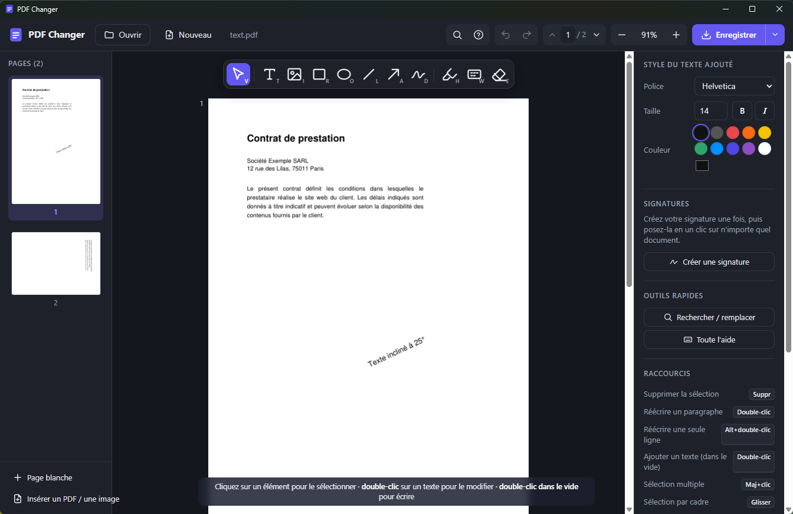

# PDF Changer

Éditeur de PDF pour Windows : modifier le texte d'un PDF, supprimer ou déplacer des éléments, ajouter des
images, signer, remplir un formulaire, réorganiser les pages… en quelques clics.
Tout se passe sur votre ordinateur : **aucun fichier n'est envoyé sur Internet**.



## Télécharger et installer

1. Téléchargez **[PDF-Changer-Windows.zip](https://github.com/scarlanathan/pdf-changer/releases/latest/download/PDF-Changer-Windows.zip)**
   (~45 Mo, page de la [dernière version](https://github.com/scarlanathan/pdf-changer/releases/latest)).
2. Décompressez-le où vous voulez (clic droit › *Extraire tout…*), par exemple dans *Documents*.
3. Ouvrez le dossier `PDF Changer` et lancez **`PDF Changer.exe`**.

Rien d'autre à installer : il suffit de **Windows 10 ou 11**.

> **Au premier lancement**, Windows peut afficher « Windows a protégé votre ordinateur » : l'application
> n'est pas signée numériquement. Cliquez sur **Informations complémentaires**, puis **Exécuter quand même**.

**Ouvrir vos PDF par double-clic** : clic droit sur un fichier PDF › *Ouvrir avec* › *Choisir une autre
application* › *Rechercher une autre application sur ce PC* › sélectionnez `PDF Changer.exe` (cochez
« Toujours utiliser cette application » si vous le souhaitez).

## Prise en main en 5 minutes

1. **Ouvrir un document** : bouton **Ouvrir** (ou `Ctrl+O`), ou glissez un fichier sur la fenêtre.
   PDF, images (JPG, PNG…), XPS et EPUB sont acceptés ; pour un PDF protégé, le mot de passe est demandé.
   **Nouveau** crée un document vierge.
2. **Sélectionner** : cliquez sur un texte, une image ou une forme. Une petite barre apparaît au-dessus
   (Modifier, Dupliquer, Supprimer) et le panneau de droite affiche ses réglages. Le **clic droit** donne
   toutes les actions possibles. Pour en sélectionner plusieurs : `Maj`+clic, ou tracez un cadre dans le vide.
3. **Modifier un texte** : **double-cliquez** dessus et tapez. Un paragraphe se remet en forme tout seul
   dans sa largeur ; `Entrée` valide, `Échap` annule. Pour écrire un nouveau texte, double-cliquez dans
   une zone vide.
4. **Ajouter quelque chose** : choisissez un outil dans la barre au-dessus de la page (texte, image,
   formes, dessin, surligneur, cache blanc, gomme), puis cliquez ou glissez sur la page.
   Pour **signer**, prenez l'outil Dessin, puis « Créer une signature » dans le panneau de droite : elle
   sera gardée pour la poser ensuite en un clic sur n'importe quel document.
5. **Enregistrer** : bouton **Enregistrer** (ou `Ctrl+S`), choisissez l'emplacement. Votre fichier
   d'origine n'est jamais modifié tant que vous ne l'écrasez pas vous-même. Un point ● à côté du nom du
   document signale des modifications non enregistrées.

Une erreur ? **`Ctrl+Z`** annule (et `Ctrl+Y` rétablit), autant de fois que nécessaire.
La barre en bas de la fenêtre indique toujours ce que l'on peut faire avec l'élément survolé, et
**`?`** affiche l'aide complète des raccourcis.

## Tout ce qu'on peut faire

### Texte
| Action | Comment |
| --- | --- |
| Réécrire un paragraphe | Double-clic : le texte se remet en forme dans la largeur du bloc (alignement conservé) |
| Réécrire une seule ligne | `Alt` + double-clic ; une ligne au style mixte (mot en gras, exposant) garde ses styles |
| Mettre en forme | Pendant l'édition, barre flottante : police, taille, gras, italique, couleur, alignement ; poignée à droite pour la largeur |
| Ajouter un texte | Double-clic dans le vide, ou outil `T` |
| Rechercher / remplacer | `Ctrl+F` / `Ctrl+H` ; le style de chaque mot est conservé |
| PDF scanné (image) | À l'ouverture, « Rendre le texte modifiable » reconnaît le texte (OCR) ; il se modifie ensuite comme un PDF normal |

### Éléments
| Action | Comment |
| --- | --- |
| Supprimer | Sélectionner puis `Suppr` ; la suppression est **réelle** (le contenu est retiré du fichier) |
| Déplacer / redimensionner | Glisser l'élément ou ses poignées ; flèches du clavier pour ajuster (`Maj` = ×10). Des guides aident à aligner (`Ctrl` pour les désactiver) |
| Dupliquer | `Ctrl+D`, ou `Alt` + glisser |
| Copier / couper / coller | `Ctrl+C`, `Ctrl+X`, `Ctrl+V`, y compris vers une autre page |
| Images | Outil `I`, coller une image (`Ctrl+V`) ou glisser un fichier image sur la page |
| Formes et dessin | Rectangle `R`, ellipse `O`, ligne `L`, flèche `A`, dessin libre `D` |
| Surligner | Outil `H` |
| Masquer une zone | Cache blanc `W` (le contenu reste dessous) |
| Effacer une zone | Gomme `E` (tout ce qu'elle contient est supprimé du fichier) |
| Signature | Outil `D` › « Créer une signature » ; puis clic sur la signature et sur la page, ou clic droit › « Signer ici » |
| Formulaire | Cliquer dans un champ (fond bleuté) et taper ; `Tab` passe au champ suivant ; cases, boutons et listes d'un clic |

### Pages et document
| Action | Comment |
| --- | --- |
| Pivoter, dupliquer, supprimer, page blanche | Boutons au survol d'une miniature (à gauche) ou clic droit dessus |
| Réordonner | Glisser une miniature |
| Plusieurs pages à la fois | `Ctrl`/`Maj`+clic sur les miniatures, puis la barre d'actions en bas à gauche |
| Insérer un autre PDF ou une image | « Insérer un PDF / une image », ou glisser le fichier sur une miniature |
| Aller à une page | Numéro en haut de la fenêtre, `PageUp` / `PageDown` |
| Zoom | Pourcentage en haut (50 % à 400 %, largeur, page entière), `Ctrl`+molette, `Ctrl+0` / `Ctrl+9` |
| Extraire des pages / réduire la taille | Flèche à côté d'« Enregistrer » (`Ctrl+Maj+S`) : pages choisies, images recompressées pour l'envoyer par e-mail |

### Confort
- **Tout au clavier** : `Tab` / `Maj+Tab` parcourt les éléments de la page, `Entrée` modifie, `Maj+F10` ouvre le menu.
- **Petit écran, tablette** : les panneaux se replient derrière deux boutons en haut de la fenêtre ; au doigt, un
  élément sélectionné se déplace.
- Le PDF enregistré reste léger : seuls les caractères utilisés des polices ajoutées y sont intégrés.

## Bon à savoir

- **Confidentialité** : aucune connexion à Internet n'est nécessaire ni utilisée. La reconnaissance de texte
  utilise le moteur intégré à Windows, dans la langue de Windows.
- **Signatures et réglages** sont gardés sur votre ordinateur, dans `%LOCALAPPDATA%\PDF Changer`, avec un
  journal (`journal.txt`) utile en cas de problème.
- Si vous fermez la fenêtre avec des modifications non enregistrées, l'application demande confirmation.

### Limites connues
- Le texte écrit de droite à gauche (hébreu, arabe) ne peut pas encore être réécrit : l'application le signale
  et laisse la ligne telle quelle. Chinois, japonais, coréen et symboles fonctionnent.
- Un texte modifié reprend la police d'origine quand elle est intégrée au PDF et contient les caractères
  nécessaires ; sinon une police proche est utilisée.
- Quand un paragraphe entier est réécrit, il prend un style unique : un mot en gras au milieu redevient
  normal. Pour garder ces styles, modifiez la ligne seule (`Alt` + double-clic) ou utilisez Rechercher / remplacer.
- La reconnaissance de texte peut se tromper sur des scans de mauvaise qualité.

## Pour les développeurs

Prérequis : Windows 10/11 et Python 3.10 ou plus récent.

```
pip install -r requirements.txt
python app.py          # dans le navigateur (http://127.0.0.1:5173) ; ou « Lancer PDF Changer.bat »
pip install pywebview
python desktop.py      # dans une fenêtre, comme l'application Windows
python build_exe.py    # construit dist/PDF Changer/PDF Changer.exe et l'archive .zip
```

- `app.py` : serveur local (Flask) et moteur d'édition (PyMuPDF) ; `static/` : l'interface ;
  `desktop.py` : la fenêtre Windows (pywebview / Edge WebView2) ; `build_exe.py` : l'exécutable (PyInstaller).
- `build_exe.py` prépare tout seul un environnement Python propre dans `build/` (Internet nécessaire la
  première fois), pour que l'application n'embarque que le nécessaire.
- PyMuPDF est figé à la version testée dans `requirements.txt` : l'historique d'annulation utilise certaines
  de ses fonctions internes.
- Sécurité : le serveur n'écoute que sur l'ordinateur (127.0.0.1) et exige un jeton propre à chaque lancement,
  connu de la seule page de l'application ; un autre site ouvert dans le navigateur ne peut pas l'utiliser.

## Licence

Copyright (C) 2026 Nathan Han

Ce programme est un logiciel libre, distribué sous la licence **GNU Affero General Public License v3.0**
(voir le fichier [`LICENSE`](LICENSE)) : vous pouvez l'utiliser, l'étudier, le modifier et le redistribuer,
à condition de partager vos modifications sous la même licence — y compris si vous le proposez comme
service en ligne. Il est fourni sans aucune garantie.

PDF Changer s'appuie sur [PyMuPDF](https://github.com/pymupdf/PyMuPDF), lui-même sous licence AGPL-3.0.
Les licences des autres composants (bibliothèques, icônes Feather et Lucide) sont détaillées dans
[`THIRD_PARTY_NOTICES.md`](THIRD_PARTY_NOTICES.md).
